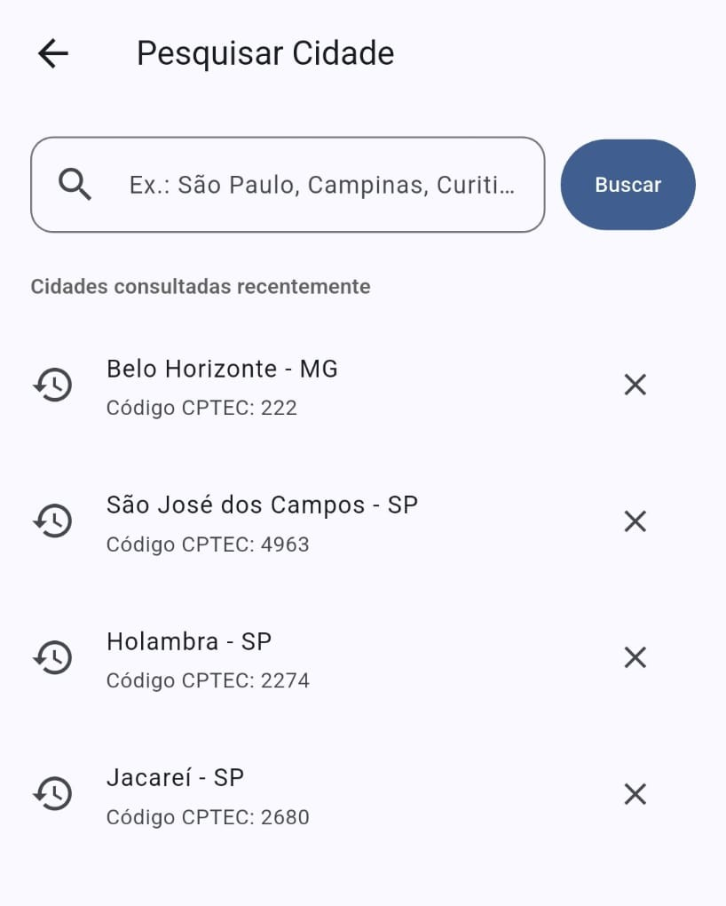
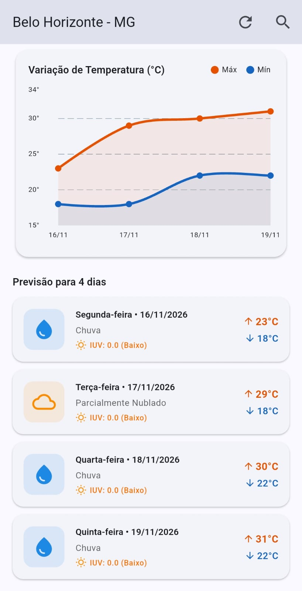
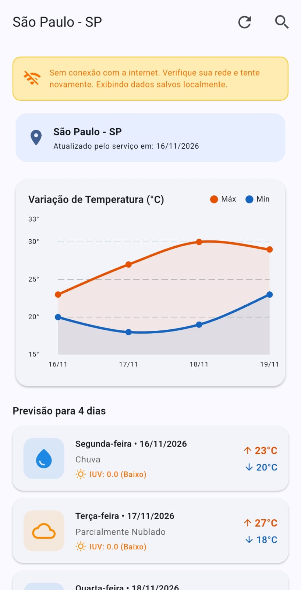

# Previsão do Tempo — CPTEC/INPE (Atividade 2)

Aplicativo Flutter desenvolvido para a disciplina **Programação para Dispositivos Móveis I** (Fatec), consumindo o serviço público em **XML** do **CPTEC/INPE** para consulta de cidades brasileiras, visualização da previsão de 4 dias e gráficos de variação de temperatura.

## Funcionalidades Implementadas

- **Pesquisa de Cidades:** Consulta localidades no endpoint `/XML/listaCidades` com normalização de acentos, exibindo nome, UF e código identificador retornado pelo serviço.
- **Previsão para 4 Dias:** Consulta `/XML/cidade/{id}/previsao.xml` e exibe data de atualização, data de cada dia, temperaturas mínima e máxima (°C), descrição legível da condição do tempo (conversão das siglas oficiais do CPTEC/INPE), ícone representativo e Índice Ultravioleta (IUV) quando disponível.
- **Gráfico de Temperaturas:** Gráfico interativo de linhas comparando temperaturas mínimas e máximas ao longo dos dias retornados (`fl_chart`).
- **Navegação entre Telas:** Navegação fluida entre a tela principal de previsão e a tela de pesquisa de cidades.
- **Atualização e Tratamento de Erros:**
  - Botão de atualização e *pull-to-refresh*.
  - Indicadores de carregamento durante requisições.
  - Tratamento de cidade não encontrada, indisponibilidade do serviço, falhas de conexão/timeout, XML inválido e campos ausentes (como IUV).
  - Identificação explícita do **CPTEC/INPE** como fonte dos dados.

## Bibliotecas Utilizadas

- [`http`](https://pub.dev/packages/http): Requisições HTTP ao serviço do CPTEC/INPE.
- [`xml`](https://pub.dev/packages/xml): Interpretação (parse) dos documentos XML retornados pela API.
- [`shared_preferences`](https://pub.dev/packages/shared_preferences): Persistência local no dispositivo.
- [`fl_chart`](https://pub.dev/packages/fl_chart): Construção do gráfico de linhas de temperatura mínima e máxima.
- [`intl`](https://pub.dev/packages/intl): Suporte a formatação/internacionalização.

## Estratégia de Persistência Local

Foi adotado o armazenamento chave-valor com **`SharedPreferences`** (serialização em JSON) na classe `StorageService` (`lib/services/storage_service.dart`):

1. **Última cidade selecionada (`ultima_cidade`):** Permite que, ao reabrir o aplicativo, a última cidade consultada seja carregada automaticamente.
2. **Cache da última previsão (`previsao_cache_<id>`):** Salva a última resposta válida da previsão de cada cidade. Caso ocorra falha de rede ou indisponibilidade do serviço, o aplicativo exibe os dados salvos em cache com um aviso de modo offline.
3. **Histórico recente de cidades (`historico_cidades`):** Mantém até 8 cidades consultadas recentemente na tela de pesquisa para acesso rápido com um toque.

## Instruções para Executar o Projeto

1. Acesse a pasta do projeto:
   ```bash
   cd Atividade_02
   ```
2. Caso as pastas de plataforma (`android/`, `ios/`, etc.) ainda não tenham sido geradas neste diretório, gere-as sem sobrescrever o código em `lib/`:
   ```bash
   flutter create . --project-name previsao_tempo
   ```
3. **Importante (Android):** Como o serviço do CPTEC/INPE utiliza `http://` (sem HTTPS), habilite o tráfego cleartext no arquivo `android/app/src/main/AndroidManifest.xml` dentro da tag `<application>`:
   ```xml
   <uses-permission android:name="android.permission.INTERNET" />
   ...
   <application
       android:usesCleartextTraffic="true"
       ...>
   ```
4. Instale as dependências e execute o aplicativo:
   ```bash
   flutter pub get
   flutter run
   ```
5. Para rodar os testes unitários do parser XML e utilitários:
   ```bash
   flutter test
   ```

## Capturas de Tela

> - Tela inicial / Pesquisa de cidades:
> 


> - Previsão de 4 dias e gráfico de temperaturas
>
> 
> 
> - Tratamento de erro / Modo offline
>
> 
>
> 
